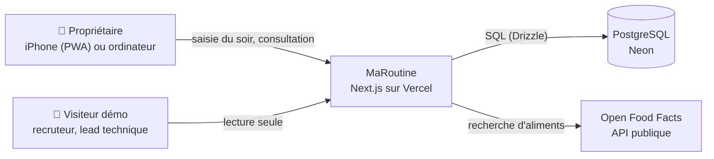
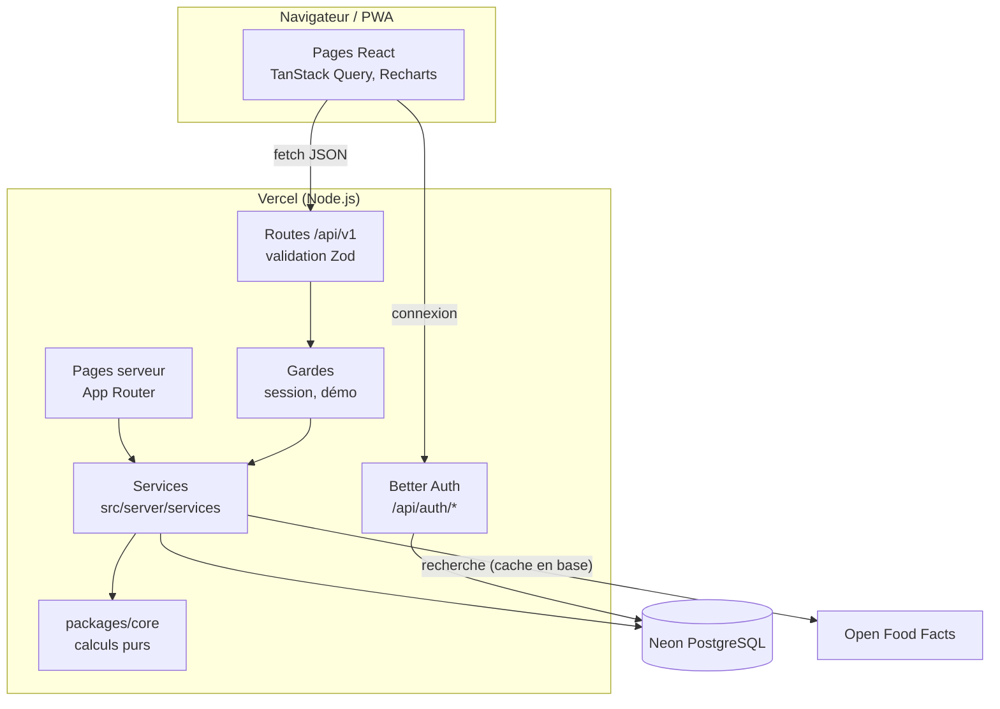
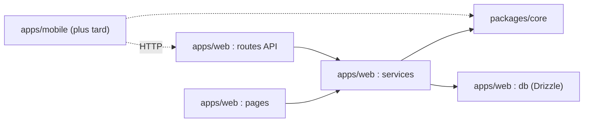
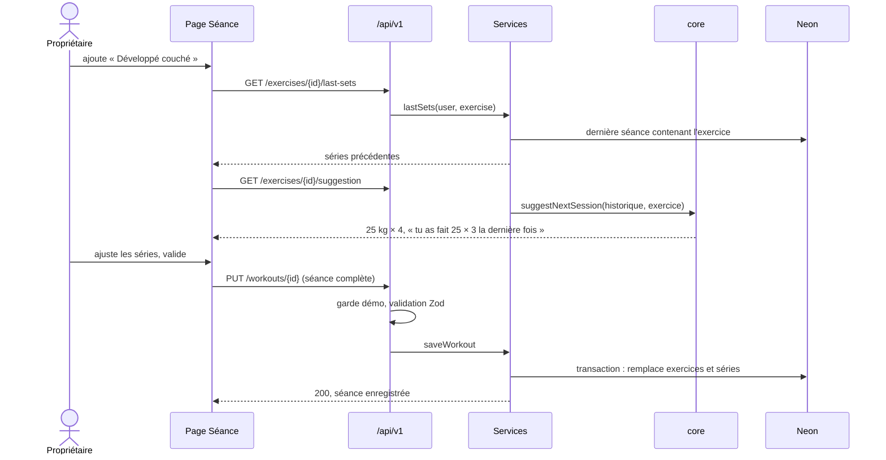
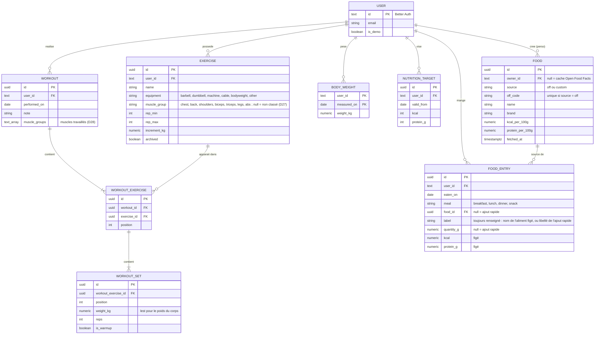

# Architecture

> Spec : [SPEC.md](SPEC.md). Décisions : [decisions-ouvertes.md](decisions-ouvertes.md) et [adr/](adr/).

## En une phrase

Une seule application Next.js hébergée sur Vercel sert à la fois l'interface React (PWA) et une API REST. L'API lit et écrit dans PostgreSQL Neon et délègue tous les calculs à `packages/core`, un module TypeScript pur que la future app iPhone réutilisera.

## 1. Contexte (C4 niveau 1)



## 2. Conteneurs (C4 niveau 2)



### Responsabilités

| Élément | Rôle | Ne fait jamais |
|---|---|---|
| Pages React | Affichage, formulaires, graphiques | Calculer une stat, appeler la base |
| Routes `/api/v1` | Authentifier, valider l'entrée (Zod), appeler un service, sérialiser | Contenir de la logique métier |
| Gardes | Récupérer l'utilisateur de la session, refuser toute écriture du compte démo | Faire confiance à un identifiant d'utilisateur venu de la requête |
| Services | Orchestrer : lire la base, appeler `core`, écrire | Implémenter une formule |
| `packages/core` | Formules, règles de suggestion, croisement, schémas Zod, générateur de démo | Importer Next.js, Drizzle ou quoi que ce soit lié à l'I/O |

## 3. Couches et règle de dépendance



Une règle ESLint (`no-restricted-imports`) interdit à `packages/core` d'importer autre chose que Zod.

## 4. Séquence : la saisie du soir d'une séance



## 5. Séquence : recherche d'un aliment

```mermaid
sequenceDiagram
    actor P as Propriétaire
    participant API as /api/v1/foods/search
    participant DB as Neon
    participant OFF as Open Food Facts

    P->>API: q = "skyr"
    API->>DB: aliments perso + aliments en cache correspondant à q
    alt moins de 10 résultats locaux
        API->>OFF: recherche par nom (User-Agent identifié)
        OFF-->>API: produits (nom, marque, kcal et protéines pour 100 g)
        API->>DB: met en cache les produits complets
    end
    API-->>P: perso d'abord, puis récents, puis Open Food Facts
```

Les produits sans valeur de calories ou de protéines pour 100 g sont écartés. En cas d'erreur ou de lenteur d'Open Food Facts (plus de 3 s), on renvoie les seuls résultats locaux avec un avertissement. Voir [ADR 0007](adr/0007-alimentation-open-food-facts.md).

## 6. Calculs et statistiques

Tout ce qui suit vit dans `packages/core` et est testé unitairement.

### 6.1 Séries de travail et charge effective

- Une **série de travail** est une série non marquée « échauffement » avec au moins 1 répétition. Seules les séries de travail entrent dans les stats.
- **Charge effective** : la charge saisie, sauf pour un exercice au **poids du corps**, où c'est `poids de corps + lest`. Le poids de corps est la dernière pesée datée entre J-14 et J. Sans pesée dans cet intervalle, la charge effective est inconnue : la séance n'a ni max estimé ni volume pour cet exercice, et elle est **exclue** de la tendance (6.4), de la règle de baisse (6.5) et du croisement (6.8). Les règles 3 et 4 de la suggestion, qui ne regardent que le lest et les répétitions, s'appliquent quand même.

### 6.2 Max estimé (formule d'Epley)

```
maxEstimé(charge, reps) = charge                    si reps = 1
                        = charge × (1 + reps / 30)  si reps > 1
```

- Le **max estimé d'une séance** pour un exercice est le plus grand max estimé de ses séries de travail.
- Au-delà de 12 répétitions, la valeur est marquée « approximative ».
- Pour un exercice au poids du corps sans pesée récente, il n'y a pas de max estimé. La stat principale devient alors la meilleure série en répétitions.

Exemple du cadrage : 20 kg × 3 → 22,0 ; 20 kg × 4 → 22,7 ; 25 kg × 3 → 27,5.

### 6.3 Meilleure série et volume

- **Meilleure série** : la série de travail au plus grand max estimé. En cas d'égalité, celle à la plus grande charge. On l'affiche telle que saisie (`25 kg × 3`).
- **Volume** d'un exercice dans une séance : `Σ charge effective × reps` sur les séries de travail.

### 6.4 Tendance d'un exercice

On prend les 6 dernières séances de l'exercice ayant un max estimé, dans l'ordre chronologique.

| Situation | Tendance |
|---|---|
| Moins de 6 séances | Pas assez de données |
| Dernière séance il y a plus de 30 jours | Inactif |
| `Δ = (moyenne des 3 dernières − moyenne des 3 précédentes) / moyenne des 3 précédentes` > +1 % | En progression |
| Δ < −1 % | En régression |
| Sinon | En stagnation |

Les moyennes portent sur le max estimé de chaque séance.

### 6.5 Suggestion pour la prochaine séance

Règles de l'[ADR 0006](adr/0006-suggestions-par-regles.md), appliquées à la dernière séance **S** de l'exercice. La **charge de référence** est la plus grande charge saisie parmi les séries de travail de S (le lest pour un exercice au poids du corps). Les **séries retenues** sont les séries de travail faites à cette charge. La règle 2 ne compte que les séances ayant un max estimé.

| Ordre | Condition | Suggestion | Justification affichée |
|---|---|---|---|
| 1 | Aucune séance précédente | Aucune | « Première fois : choisis une charge confortable. » |
| 2 | Max estimé en baisse deux séances de suite (S < S-1 < S-2) | Même charge, même nombre de répétitions | « Ton max estimé baisse depuis 2 séances : garde la charge et regarde ta récupération et ton alimentation. » + lien vers la période |
| 3 | Toutes les séries retenues atteignent le haut de la fourchette | Charge + pas d'augmentation, reps = bas de la fourchette | « Tu as fait 3 × 10 à 22,5 kg, le haut de ta fourchette : passe à 25 kg. » |
| 4 | Sinon | Même charge, reps = min(reps de la première série retenue + 1, haut de la fourchette) | « Tu as fait 25 × 3 : vise 25 × 4. » |

### 6.6 Moyenne glissante du poids

Pour chaque jour J, la moyenne des pesées de J-6 à J, à condition qu'il y en ait au moins 3. Sinon, pas de valeur ce jour-là (la courbe s'interrompt).

Le **couloir du poids** ([D22](decisions-ouvertes.md#décisions-du-propriétaire)) va, chaque jour qui a une moyenne, de la plus petite à la plus grande pesée de J-6 à J.

### 6.7 Jour engagé

L'objectif en vigueur un jour donné est le dernier objectif dont la date d'effet est antérieure ou égale à ce jour.

| Statut d'un jour | Condition |
|---|---|
| Non renseigné | Aucune entrée alimentaire ce jour-là |
| Non évalué | Des entrées, mais aucun objectif en vigueur |
| Engagé | Protéines ≥ 90 % de l'objectif **et** calories entre 90 % et 110 % de l'objectif |
| Non engagé | Les autres jours renseignés |

### 6.8 Fenêtre alimentaire et croisement

- La **fenêtre alimentaire** d'une séance du jour J couvre J-3, J-2 et J-1.
- Elle est **classée** si au moins 2 de ses 3 jours sont engagés ou non engagés. Elle est **engagée** si au moins 2/3 des jours classés sont engagés, sinon **non engagée**. Une fenêtre non classée est exclue du croisement.
- **Progression d'une séance** : pour chaque exercice, `(maxEstimé(S) − maxEstimé(P)) / maxEstimé(P)`, où P est la séance précédente sur le même exercice. Les paires espacées de plus de 21 jours sont exclues, parce qu'une reprise après une coupure fausserait la comparaison.
- **Croisement** : on regroupe les progressions selon la fenêtre de S (engagée, non engagée). Pour chaque groupe, on affiche la moyenne des progressions, le nombre de progressions et le nombre de séances distinctes. « Tous exercices » fait la moyenne de toutes les progressions du groupe. Une vue par exercice fait de même pour un seul exercice.
- **Seuil** : sous 5 séances distinctes dans l'un des deux groupes, aucun chiffre n'est affiché ([F-TDB-4](SPEC.md#tableau-de-bord-et-croisement)).
- **Formulation** : toujours descriptive. « Après 3 jours bien suivis, ton max estimé a progressé en moyenne de +1,8 % (12 séances), contre −0,4 % sinon (7 séances). » Jamais « tu régresses à cause de ton alimentation ».

### 6.9 Couloir de tendance

Signature des courbes de la direction A ([D13, D18](decisions-ouvertes.md#décisions-du-propriétaire)). Pour chaque séance ayant un max estimé, le couloir va du plus petit au plus grand max estimé des 3 dernières séances ayant un max, celle-ci comprise. Il est calculé sur tout l'historique, puis coupé à la période affichée.

## 7. Modèle de données



- Les tables `session`, `account` et `verification` de Better Auth ne sont pas représentées.
- Contraintes : `rep_min ≥ 1`, `rep_max ≥ rep_min`, `increment_kg > 0`, `weight_kg ≥ 0`, `reps ≥ 0`, `quantity_g > 0` quand `food_id` est renseigné (nul pour un ajout rapide, qui exige alors un `label`), unicité `(user_id, valid_from)` sur les objectifs.
- Index : `(user_id, performed_on)`, `(user_id, eaten_on)`, `(exercise_id)` sur `workout_exercise`.
- Chaque requête de service filtre par `user_id`. Il n'y a pas de Row-Level Security : avec un seul vrai utilisateur, le filtre applicatif et les tests d'accès croisé suffisent (voir [threat-model.md](threat-model.md)).

## 8. Écrans

Direction visuelle retenue : **A — Courbes** ([décision D13](decisions-ouvertes.md#décisions-du-propriétaire), maquettes sur le [canevas](https://claude.ai/artifact/WStbXSegxDLEsFJhceFYXC), première ligne). Navigation : barre d'onglets en bas sur mobile (Accueil, Séance, Repas, Poids, Plus : D24, D30), barre latérale sur ordinateur.

| Écran | Contenu clé |
|---|---|
| Connexion | Email, mot de passe, bouton « Essayer la démo » |
| Tableau de bord (Accueil) | « Séance enregistrée. » après une nouvelle séance (D28), calendrier d'activité (D17), bloc Poids : dernière pesée, moyenne sur 7 jours, pesée du jour (D23), puis la semaine en cours, sans le nombre de séries. Au Lot 5 : tendance du poids, jours engagés, exercices par tendance, suggestions |
| Saisie du soir | Un seul écran, trois sections repliables : Séance, Pesée, Alimentation. Date du jour par défaut, modifiable |
| Séance (édition) | Muscles travaillés en tête, qui filtrent l'ajout d'exercice (D28), exercices dans l'ordre, séries préremplies, suggestion affichée à côté de chaque exercice, ajout et suppression de séries |
| Calendrier | Mois avec les jours de séance, total par semaine, accès à chaque séance |
| Exercices (dans « Plus », D30) | Filtre par groupe musculaire (D27), liste avec tendance établie et dernier max estimé, catalogue, création |
| Fiche exercice | Tendance et dernier max, suggestion justifiée, courbe du max estimé dans son couloir (1 mois, 3 mois, 1 an, tout) avec résumé textuel, historique (meilleure série, max estimé, volume). Superposition calories et protéines au Lot 5. Lien « Réglages » |
| Réglages d'un exercice | Nom, groupe musculaire, matériel, fourchette, pas d'augmentation, archivage (D21) |
| Poids | Saisie à une date passée (remplace la pesée du jour), courbe des pesées avec moyenne glissante et couloir (1 mois, 3 mois, 1 an, tout) et résumé textuel, liste avec suppression |
| Repas (journal, onglet D24) | Jour sélectionné (jour précédent, jour suivant), totaux face aux objectifs en barres, entrées par repas avec modification et suppression en place, « Copier depuis » (D26) |
| Ajouter (repas) | Repas, recherche temporisée (récents quand le champ est vide), scan du code-barres avec saisie manuelle du code (D29), quantité avec aperçu des valeurs, ajout rapide, nouvel aliment perso, mention ODbL (D25) |
| Mes aliments | Aliments perso : création, modification, suppression sans effet sur les entrées passées |
| Croisement | Comparaison après fenêtres engagées et non engagées, tous exercices et par exercice, effectifs, mention de prudence |
| Objectifs | Objectifs kcal et protéines avec une date d'effet, historique avec « En vigueur » |
| Plus | Liens Exercices, Objectifs, Mes aliments, Calendrier ; mention Open Food Facts (ODbL) ; déconnexion |

## 9. Environnements

| Environnement | Application | Base |
|---|---|---|
| Local | `pnpm dev` | Branche Neon `dev` (gratuite) |
| Tests | Vitest | PGlite en mémoire, migrations Drizzle appliquées au démarrage |
| Aperçu | Déploiement Vercel par branche | Branche Neon `preview` |
| Production | Vercel | Branche Neon principale |

Voir [ADR 0009](adr/0009-base-de-donnees-dev-et-tests.md).
