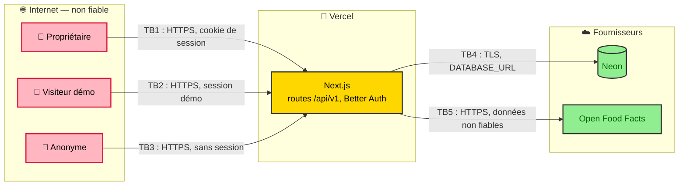

# Modèle de menaces (STRIDE)

> Analyse menée en conception, avant tout code. L'app n'a qu'un vrai utilisateur, mais elle est publique sur Internet, son code est public (portfolio), et elle contient des données de santé (poids, alimentation). Architecture analysée : [architecture.md](architecture.md). Document à revoir à chaque lot.

## Actifs à protéger

| Actif | Pourquoi c'est sensible |
|---|---|
| Pesées et alimentation du propriétaire | Données de santé au sens du RGPD. Elles sont personnelles et ne doivent jamais être visibles d'un visiteur. |
| Séances du propriétaire | Données personnelles. Elles sont moins sensibles, mais tout aussi privées. |
| Compte du propriétaire | Il donne accès à tout le reste. |
| Secrets (`BETTER_AUTH_SECRET`, `DATABASE_URL`) | Ils permettent de forger des sessions ou de lire toute la base. Le dépôt est public. |
| Historique des données | Une perte effacerait des mois de suivi, sans possibilité de les ressaisir. |

## Frontières de confiance

## Menaces

Risque = vraisemblance × impact (Faible / Moyen / Élevé).

| Id | STRIDE | Menace | Risque | Mitigation | Vérification |
|---|---|---|---|---|---|
| T-01 | **I** | Le visiteur démo lit les données du propriétaire en changeant un identifiant dans l'URL (`/api/v1/workouts/{id}`). | Élevé | L'utilisateur vient toujours de la session. Chaque requête de service filtre par `user_id`. Une ressource d'un autre utilisateur répond 404. | Tests d'accès croisé sur chaque route (NF-5) |
| T-02 | **T** | Le visiteur démo modifie ou supprime des données (les siennes ou celles du propriétaire). | Moyen | Garde serveur : toute méthode autre que `GET` d'un compte `is_demo` répond 403, ainsi que `GET /foods/search` (T-09). L'interface masque les boutons, mais ce n'est pas la protection. [ADR 0008](adr/0008-mode-demo-et-inscriptions-fermees.md) | Test sur chaque route d'écriture |
| T-03 | **S** | Un anonyme crée un compte et stocke des données. | Moyen | Inscriptions désactivées dans Better Auth. Il n'existe aucune route d'inscription. | Test : l'appel d'inscription est refusé |
| T-04 | **S** | Force brute sur le mot de passe du propriétaire. | Moyen | Limite de débit de Better Auth sur la connexion, mot de passe long imposé par `create-owner` (12 caractères minimum). | Test de limite de débit |
| T-05 | **S** | Un secret (`DATABASE_URL`, `BETTER_AUTH_SECRET`) est committé dans le dépôt public. | Élevé | `.env.example` sans valeurs, `.gitignore`, gitleaks en CI et en hook pre-commit. Secrets uniquement dans les variables Vercel et GitHub. | Étape CI |
| T-06 | **S** | Vol de session par XSS. | Faible | Rendu React (échappement), aucun `dangerouslySetInnerHTML`, cookie `HttpOnly`, `Secure`, `SameSite=Lax`, en-tête CSP. | En-têtes vérifiés en e2e |
| T-07 | **T** | Requête intersite (CSRF) qui écrit au nom du propriétaire. | Faible | Cookie `SameSite=Lax`, vérification de l'en-tête `Origin` sur les méthodes d'écriture, corps JSON obligatoire. | Test d'écriture avec `Origin` étranger |
| T-08 | **T** | Open Food Facts renvoie des données malformées ou hostiles (texte, valeurs absurdes). | Faible | Validation Zod des réponses, valeurs bornées (kcal ≤ 900 et protéines ≤ 100 pour 100 g), texte affiché échappé. | Test avec réponse invalide |
| T-09 | **D** | Un anonyme ou le visiteur démo inonde la recherche d'aliments, ce qui épuise le quota Open Food Facts de l'app. | Moyen | Recherche réservée aux sessions non démo, limite de débit par session, cache local, debounce côté interface. | Test de limite |
| T-10 | **D** | Inondation de la route de connexion démo, qui crée des sessions en masse. | Faible | Limite de débit par IP. Les sessions démo expirent après 24 h. | Test de limite |
| T-11 | **I** | Des données de santé apparaissent dans les logs Vercel. | Faible | Aucun corps de requête ni valeur de pesée ou d'alimentation dans les logs. On ne journalise que la route, le statut et la durée. | Revue de code |
| T-12 | **D** | Perte de données (erreur de migration, suppression accidentelle, problème chez Neon). | Moyen | Migrations versionnées et revues, jamais de `push` du schéma en production. La restauration à un instant donné de l'offre gratuite Neon couvre une courte fenêtre. Export régulier : voir menaces acceptées. | Revue des migrations |

## Menaces acceptées

- **Sauvegarde limitée** : la fenêtre de restauration gratuite de Neon est courte. Un export manuel (évolution « Export CSV ou JSON ») est la parade prévue. On écarte volontairement une sauvegarde automatique en artefact GitHub Actions, car le dépôt est public et ces artefacts y seraient exposés.
- **Pas de Row-Level Security PostgreSQL** : avec un seul vrai utilisateur, le filtre applicatif et les tests d'accès croisé suffisent. À reconsidérer si l'inscription était un jour ouverte.
- **Pas de double authentification** : risque jugé faible pour un compte personnel sans valeur marchande.

## Priorités par lot

| Lot | Menaces à couvrir |
|---|---|
| 0 | T-03, T-04, T-05, T-06, T-07 : authentification, en-têtes, CI avec détection de secrets |
| 1 | T-01 (séances, exercices), T-12 (première migration réelle) |
| 3 | T-01 (pesées), T-11 |
| 4 | T-01 (alimentation), T-08, T-09 |
| 6 | T-02, T-10, puis revue complète |
